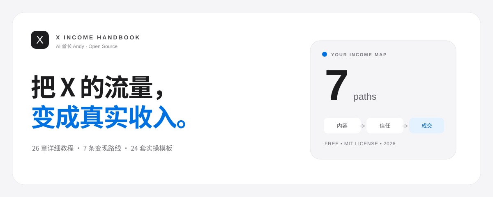

<div align="center">

<a href="https://github.com/AIPMAndy/x-income-handbook"></a>

<h1>X 赚钱实战指南</h1>
<p><strong>曝光不是收入，从定位到成交建立完整链路</strong></p>
<p>26 章教程 · 7 条变现路径 · 24 套模板</p>

<p>
<a href="https://github.com/AIPMAndy/x-income-handbook/stargazers"></a>
<a href="LICENSE"></a>
<a href="https://github.com/AIPMAndy/x-income-handbook/actions/workflows/pages.yml"></a>
</p>
<p><strong><a href="https://aipmandy.github.io/x-income-handbook/">🌐 在线网站</a> · <a href="chapters/">📖 系统章节</a> · <a href="templates/">🧩 24 套模板</a> · <a href="research/sources.md">📚 规则来源</a></strong></p>

<p><a href="https://github.com/AIPMAndy/github-income-handbook">GitHub 赚钱</a>　·　<a href="https://github.com/AIPMAndy/x-income-handbook">X 赚钱</a>　·　<a href="https://github.com/AIPMAndy/threads-income-handbook">Threads 赚钱</a></p>

<p><sub>AI 酋长 Andy · <a href="https://metaver.vip/">个人官网</a> · <a href="https://metaver.vip/services">咨询与陪跑</a> · 微信：<code>AIPMAndy</code></sub></p>

</div>

**X（Twitter）怎么赚钱？** 这是 AI 酋长 Andy 写的免费开源中文指南：26 章教程、7 条变现路径、24 套模板和 30 天计划，覆盖内容增长、真实成交与 X 创作者规则。曝光不是收入，本项目不承诺涨粉或收入。

*How to make money on X (Twitter): a free, open-source Chinese guide by AI Chief Andy (@AIPMAndy), with 26 chapters, 7 monetization paths and 24 templates.*


## 3 分钟开始

1. **选择方向**：先读下方「先看结论」，按能力和资格选择可行的变现路径。
2. **套用模板**：打开 [实操模板](templates/)，先做内容和服务报价的最小验证。
3. **检查资格**：涉及官方奖励时先读 [官方资格对照表](templates/22-policy-check-matrix.md)，不要把总曝光当收入。

## 先看结论

X 的「曝光」不是「到账」。如果你擅长解决问题，优先验证**咨询/陪跑或数字产品**；有开发能力的可以验证 SaaS；能持续提供原创内容且符合全部资格时，再考虑**官方原创奖励与创作者订阅**。

**关键变更**：X 旧版 `Creator Revenue Sharing` 于 **2026-09-07** 停止；新版 `Original Content Rewards` 对最近 90 天内至少 **500,000 次来自认证用户的 Home Timeline 曝光（回复不计入门槛）**、**500 位认证粉丝**、付费套餐、年龄、地区、原创性、账号状态等有要求。提交申请也不保证批准。**中国大陆目前不在官方公布的新版奖励适用地区列表中**（列表列有香港和台湾）；以实际资格与最新名单为准。新版合格曝光定义更严格，不能拿个人主页的「总曝光」乘虚构单价。见 [X 原创奖励官方政策](https://help.x.com/en/using-x/original-content-rewards)。

## 包含什么

| 资源 | 数量 | 说明 |
|---|---:|---|
| 变现路线 | 7 | 咨询、数字产品、AI/SaaS、联盟、商单、订阅、原创奖励 |
| 系统教程 | 26 | 每章包含场景演练、逐步操作、完成标准、失败处理、交付物及来源 |
| 实操模板 | 24 | 英文帖子、Thread、服务卡、商单 Media Kit、合同检查、收益复盘、CSV 等 |
| 30 天计划 | 30 | 每天一个动作，进度仅保存在浏览器本地 |
| 计算器 | 1 | 业务收入的**假设模型**，不预测 X 平台奖励 |
| 官方参考 | 9 | X 帮助中心 / FTC，定期人工核验 |

## 零门槛使用

1. 打开 `index.html`，无需 Node.js 或数据库，网站核心交互离线可用。
2. 用搜索框找章节、点开阅读、勾选 30 天任务、在工具箱调整收入参数。
3. `chapters/` 是可单独阅读和引用的 Markdown 文档。
4. `templates/` 是可编辑的 `.md` / `.csv` 文件。
5. 微信号 `AIPMAndy` 和 [官网](https://metaver.vip/) 已在网站导航与服务区提供。

## 本地开发

```bash
python3 -m http.server 8000
# 打开 http://localhost:8000
python3 scripts/check.py
python3 -m unittest discover -s scripts -p 'test_*.py' -v
node scripts/smoke_dom.cjs # 在无浏览器运行环境下验证 JS 初始化及核心输出
```

直接打开 `index.html` 也可以，因为章节数据在 `data/content.js` 中，未依赖外部 API。

## 验证边界与测试

- 内容同步检查、Python 单元测试和 JavaScript 无浏览器运行时检查已通过。
- `scripts/browser_smoke.py` 提供点击、弹窗、资格检查及视觉截图的真实浏览器验收脚本，但**本次执行环境的浏览器禁止访问本地地址和 file URL，未获得有效新版截图**。部署后需在能访问本地网页的环境里执行。
- 远程仓库已经创建；上线后仍需实测手机版、分享预览及关键交互，不能用构建成功代替浏览器验收。

## 一键开源发布

仓库已经建立。`publish.sh` 保留给需要从本地副本首次发布到其他新仓库的维护者；不会覆盖已有仓库。详见 [PUBLISH.md](PUBLISH.md)。

## GitHub Pages 部署

本仓库已创建，默认分支为 `main`，提供 [Pages 自动部署工作流](.github/workflows/pages.yml)。

1. 到仓库 **Settings → Pages** 确认发布源设置为 **GitHub Actions**。
2. 在 [Actions](https://github.com/AIPMAndy/x-income-handbook/actions) 查看最新部署是否成功。
3. 访问 [在线网站](https://aipmandy.github.io/x-income-handbook/)，实测手机版、章节阅读与模板下载。
4. 如要设置 GitHub 仓库右侧的社交分享图，请到 **Settings → General → Social preview** 上传 `assets/social-preview.png`（需手动操作）。

GitHub Actions 检查成功不等于已完成手机端和分享预览的实际验收。

## 目录

```text
index.html                    交互网站
assets/style.css              编辑式排版 + 响应式样式
assets/app.js                 章节搜索、路线、计算器、打卡
assets/favicon.svg            网站标识
assets/social-preview.png     可手动上传到 GitHub 的社交预览图
data/content.json             唯一内容主数据（维护来源）
data/content.js               由 JSON 生成的静态脚本
data/templates.js            模板索引
chapters/01.md ... 26.md      26 篇 Markdown 手册
templates/                    24 套编辑模板
research/sources.md           官方规则与核验日期
research/red-team.md          对抗式审核与风险清单
scripts/check.py              结构/内容/链接基础校验
scripts/test_content.py       单元测试
.github/workflows/ci.yml      持续集成
.github/workflows/pages.yml   GitHub Pages 自动部署
LICENSE                       MIT
```

## 维护内容

编辑 `data/content.json` 后，运行：

```bash
python3 scripts/sync.py
python3 scripts/check.py
```

`sync.py` 会同步 `data/content.js` 与 26 篇章节文件，避免在线网站和 Markdown 内容不一致。

## V2 对抗式审核与升级

- 针对原版“讲概念多、操作证据少”：26 章新增具体场景、分步实操、验收标准和卡住后的调整方案。
- 原创奖励和 Subscriptions **严格分离**：另外附上两套申请资格对照表 `templates/22-policy-check-matrix.md`。
- 补充 14 天首单验证实验、双语示范、失败时的停/改策略；不以泛流量当商业结果。
- 网站增加本地原创奖励资格自检、零单概率、税前每小时贡献指标；不收集/上传用户输入。移动端增加快捷导航，章节全文搜索包含实操案例。
- 修正商单品类警告：金融、加密货币等属于 Paid Partnerships 明确禁止推广的品类。
- 详细问答与修复证据见 `research/adversarial-dialogue.md`。

## 原则和限制

- 不提供虚假地址、假身份、代实名、刷量、群发、绕开平台地区限制的操作。
- 不承诺涨粉或收入；工具中的数字是场景假设，并非业绩案例。
- 所有费用、资格、区域、支付方法都可能更新，优先查官方最新文档。
- 转载第三方图片、界面截图、他人内容须遵守相应版权；MIT 只适用本仓库拥有版权的原创作品，不覆盖引用资料、外部商标或 X 官方内容。
- 不构成税务、投资、法律或财务专业意见。

## 参与贡献

欢迎 Issue / Pull Request 修正文档。规则更新请附**原始官方链接、核验日期和变更前后差异**；案例必须附可核验证据且保护客户隐私；不要提交营销垃圾内容。

## 常见问题 FAQ

### X 的创作者收入分成还能用吗？

旧版 `Creator Revenue Sharing` 已在 2026-09-07 停止，现在是新版 `Original Content Rewards`，有曝光量等资格门槛。开始前先看上方「先看结论」和 [官方资格对照表](templates/22-policy-check-matrix.md)。规则可能更新，以 X 官方最新文档为准。

### 在 X 上有哪些变现路径？

这份指南整理了 7 条：咨询、数字产品、AI/SaaS、联盟、商单、订阅、原创奖励。

### 新手应该先做哪一条？

擅长解决问题的，先验证咨询/陪跑或数字产品；有开发能力的，可以验证 SaaS；能持续做原创内容并且符合全部资格时，再考虑原创奖励。

### 这份指南收费吗？作者是谁？

教程免费开源（MIT）。作者是 AI 酋长 Andy（Andy Liu，GitHub/X @AIPMAndy）：前腾讯/百度 AI 产品专家，大模型独角兽前 VP，现专注 AI + 产品方法论创业。

<!-- andy-author-card:start -->
## 作者 / About the author

**AI 酋长 Andy（Andy Liu，GitHub/X @AIPMAndy）**：前腾讯/百度 AI 产品专家，大模型独角兽前 VP，现专注 AI + 产品方法论创业。

微信 `AIPMAndy`（备注「X 赚钱攻略」） · [X @AIPMAndy](https://x.com/AIPMAndy) · [Telegram @AIPMAndy](https://t.me/AIPMAndy) · [个人官网 metaver.vip](https://metaver.vip/)

*AI Chief Andy (Andy Liu, @AIPMAndy on GitHub and X) is a former Tencent and Baidu AI product expert and former VP at an LLM unicorn, now a serial entrepreneur focused on AI and product methodology.*

### Andy 的其他免费指南

- [GitHub 赚钱实战指南](https://aipmandy.github.io/github-income-handbook/)：20 章教程、7 条变现路径、30 天执行计划
- [Threads 赚钱实战指南](https://aipmandy.github.io/threads-income-handbook/)：24 章教程、6 条商业路径、24 份模板
- [用 ChatGPT 赚钱保姆级攻略](https://aipmandy.github.io/chatgpt-income-handbook/)：34 章教程、10 个服务包、64 套提示词
- [失业自救手册](https://aipmandy.github.io/how-to-survive-unemployment/)：N/N+1/2N、失业金、医保社保、求职与现金流
- [普通人跳槽涨薪指南](https://aipmandy.github.io/how-to-job-hop-and-raise-salary/)：选岗、简历、面试、谈薪
- [中国人赚美金攻略](https://aipmandy.github.io/how-to-earn-usd-from-china/)：8 种海外收入路线
- [Grok Bot 中文攻略](https://aipmandy.github.io/grok-bot-handbook/)：AI Agent 中文教程

<!-- andy-author-card:end -->
